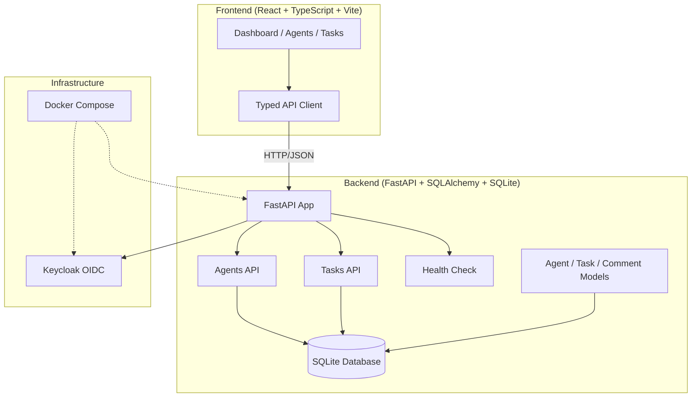

# Prism Workbench | Alan Vo | AI & Machine Learning

> Work in progress. This checkpoint may be incomplete or fail tests. See PLAN.md and STATUS.md before use.


**Prism Workbench** is an open-source AI agent orchestration platform for managing autonomous AI agents at work. It provides a control plane for organizing agents into hierarchical teams, assigning tasks with governance, tracking costs, and monitoring execution — all from a single dashboard.

## The Problem

As AI agents become more capable, developers and teams run many agents simultaneously (Claude Code, Codex, Cursor, custom CLI agents, HTTP bots). Without orchestration, context is fragmented across terminals, costs spiral uncontrolled, and there's no unified view of what agents are doing or why.

## The Approach

Prism Workbench implements a deterministic agent orchestration engine with:
- **Hierarchical agent org charts** — agents have roles, reporting lines, and permissions
- **Task management with atomic checkout** — tasks are assigned, worked, and reviewed with status transitions
- **Heartbeat-based execution** — agents poll for work; the server coordinates wakeups and budget checks
- **Budget enforcement** — per-agent and per-project cost limits with hard stops
- **Offline-first core** — all orchestration works without LLM keys; LLM explanations are opt-in and advisory

## Intended User

Engineering teams and AI researchers running multiple autonomous agents who need a centralized control plane for coordination, governance, and cost control.

## Quickstart

### Prerequisites
- Python 3.12+
- Node.js 24+
- Docker (optional, for full stack with Keycloak)

### Local Development (Backend Only)
```bash
cd backend
python3 -m venv .venv
source .venv/bin/activate
pip install -r requirements.txt
cp ../.env.example .env
uvicorn app.main:app --reload --host 127.0.0.1 --port 8000
```

### Local Development (Frontend Only)
```bash
cd frontend
npm install
npm run dev
```

### Full Stack with Docker
```bash
docker-compose up --build
```
- Frontend: http://127.0.0.1:3000
- Backend API: http://127.0.0.1:8000
- Keycloak: http://127.0.0.1:8080 (admin/admin)

## Architecture



## API Endpoints

### Health
- `GET /health` — Health check

### Agents
- `POST /api/agents` — Create agent
- `GET /api/agents` — List agents (pagination, status filter)
- `GET /api/agents/{id}` — Get agent
- `PATCH /api/agents/{id}` — Update agent
- `DELETE /api/agents/{id}` — Delete agent

### Tasks
- `POST /api/tasks` — Create task
- `GET /api/tasks` — List tasks (pagination, status filter, assignee filter)
- `GET /api/tasks/{id}` — Get task
- `PATCH /api/tasks/{id}` — Update task
- `DELETE /api/tasks/{id}` — Delete task
- `POST /api/tasks/{task_id}/assign/{agent_id}` — Assign task to agent
- `POST /api/tasks/heartbeat` — Agent heartbeat (polls for assigned work)
- `POST /api/tasks/{task_id}/comments` — Add comment to task
- `GET /api/tasks/{task_id}/comments` — List task comments

## Security Limitations

- **Demo mode** binds to localhost only; refuses to start in production without explicit configuration
- **No authentication implemented yet** — OIDC/Keycloak integration is planned (see roadmap)
- **CORS** allows all origins in development; configure for production
- **SQLite** for development only; use PostgreSQL for production
- **No rate limiting** on API endpoints
- **Secrets** must be provided via environment variables; never committed

## Provider Configuration

| Variable | Description | Default |
|----------|-------------|---------|
| `LLM_API_KEY` | API key for LLM provider | (required for LLM features) |
| `LLM_PROVIDER` | Provider type: `openai-compatible`, `anthropic`, `gemini`, `ollama` | `openai-compatible` |
| `LLM_MODEL` | Model identifier | `gpt-4o-mini` |
| `LLM_BASE_URL` | Custom base URL for OpenAI-compatible endpoints | (none) |

## SSO/SAML Setup (Planned)

Keycloak supports upstream SAML IdPs through identity brokering. Realm import configuration will be provided in `keycloak/realm-export.json`.

## AI/ML Evaluation

Prism Workbench's core orchestration engine is deterministic and works offline. LLM-powered features (advisory explanations, skill generation) are opt-in and labeled as such.

**Reproducible baseline**: Run the backend tests to verify task assignment, heartbeat polling, and budget enforcement logic without any LLM keys.

```bash
cd backend
PYTHONPATH=. .venv/bin/python -m pytest tests/ -v
```

**Failure cases**:
- Agent heartbeat returns no work when no tasks assigned
- Budget limits prevent task assignment when exceeded
- Inactive agents cannot receive work
- Task status transitions follow defined workflow

---

**Alan Vo** | alanvo@gmail.com
